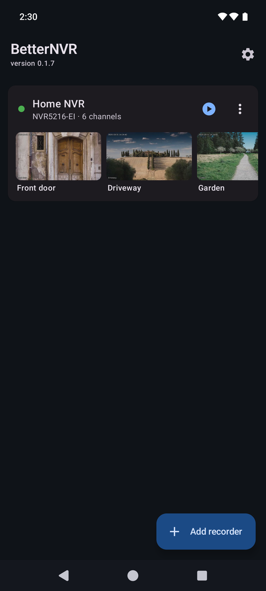
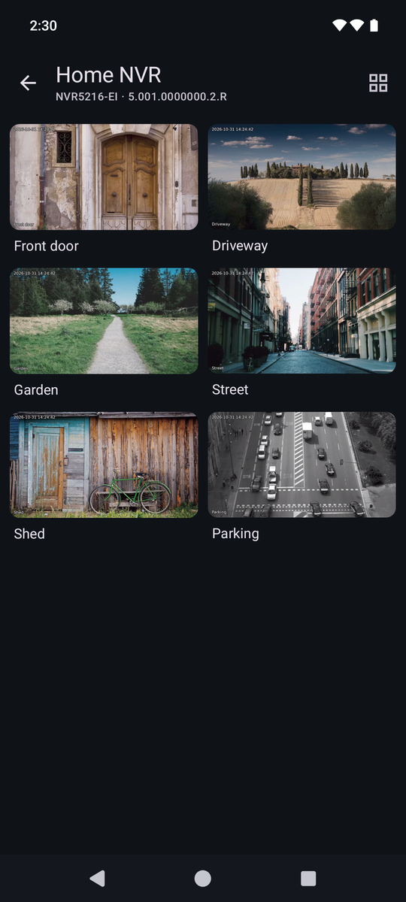
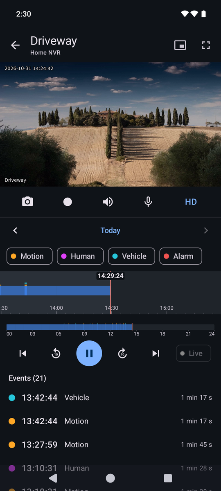

<p align="center">
  
</p>

<h1 align="center">BetterNVR</h1>

<p align="center">
  Open-source Android app for Dahua NVRs and IP cameras.<br>
  It talks to your recorder directly on port 37777 – no cloud, no account, no tracking.
</p>

<p align="center">
  <a href="../../releases/latest"><b>⬇ Download the latest APK</b></a>
</p>

<p align="center">
  &nbsp;
  &nbsp;
  
</p>
<p align="center"><sub>Screenshots from a demo recorder with stock photos (Unsplash).</sub></p>

## Features

- Live view in HD or SD with sound; snapshots and clips (always with sound)
- Recordings on a timeline with motion, human, vehicle and alarm events, a calendar, 1×–8× speed and MP4 download
- Camera grid and multi-view (1 / 4 / 9 / 16)
- PTZ, two-way talk and active deterrence (siren)
- Pinch zoom, full screen, picture-in-picture
- Home-screen widget with the latest picture of a camera
- Recorders shared as QR codes
- English and Polish
- Updates from this repository's releases

## Install

Download the APK from the [latest release](../../releases/latest) and open it on your phone (Android 8.0 or newer).
New versions then show up in the app; it checks GitHub at most once a day, and this can be switched off in settings.

Tested with NVR4216-EI, NVR5216-EI and the DH-C4K-P camera; other Dahua devices that DMSS reaches on port 37777
should work too.

## Privacy and security

- The app connects only to the recorders you add, and to GitHub for updates.
- An update is installed only if it carries the release workflow's Ed25519 signature (`.sig` next to the APK,
  checked against the public key built into the app) and the app's own signing key.
- Dahua's port-37777 protocol is not encrypted: the password never travels, but picture and sound do.
  Away from home, reach your recorders through a VPN rather than an open port.
- Recorder logins stay on the phone and are excluded from backups.

## Building

```sh
./gradlew assembleDebug
```

Needs JDK 17 or newer and the Android SDK (platform 35).

## License

[GPL-3.0](LICENSE). BetterNVR is an independent project, not affiliated with Dahua Technology;
Dahua and DMSS are trademarks of their owners.

---

**Po polsku:** BetterNVR to otwarta aplikacja na Androida do rejestratorów i kamer Dahua – podgląd na żywo, nagrania
ze zdarzeniami, PTZ, rozmowa, odstraszanie, widżet i kody QR. Łączy się bezpośrednio z rejestratorem, bez chmury
i konta. Plik APK jest w [najnowszym wydaniu](../../releases/latest).
